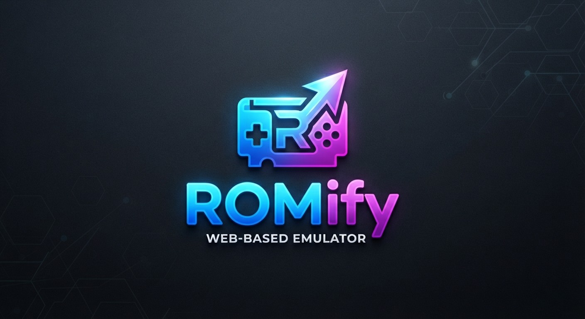

<div align="center">



### 🕹️ Dein Retro-Arcade im Browser 👾
**Kein Download. Kein Setup. Einloggen, Spiel wählen, loslegen.** ⚡

[](https://cursor-it.github.io/ROMify/)


</div>

---

## ▶️ Press Start 🔥

ROMify ist ein webbasierter Retro-Emulator für **Handy 📱 und PC 💻**. Du meldest dich an, wählst ein Spiel aus dem Katalog und spielst sofort im Browser. Deine Spielstände 💾, Spielzeit ⏱️ und Erfolge 🏆 folgen dir auf jedes Gerät.

Der Katalog enthält ausschließlich **selbst erstellte oder frei lizenzierte Spiele (Homebrew)** 💜. Er wird von Admins 🛡️ gepflegt.

## 🎮 Features ✨

- ⚡ **Sofort spielen:** Emulation per WebAssembly (EmulatorJS), Touch-Gamepad auf dem Handy, Tastatur und Controller am PC
- ☁️ **Login & Cloud-Saves:** Spielstände werden automatisch in der Datenbank gesichert und geräteübergreifend geladen
- 🏆 **Highscore-Feeling:** Erfolge für Spielzeit, Sammlung und Konsolen
- 🏠 **Dein Hauptmenü:** zuletzt gespielt, meine Spiele, neu im Katalog und Empfehlungen, die sich an dein Spielverhalten anpassen (zum Beispiel mehr aus der Pokémon-Reihe, wenn du Pokémon spielst)
- 📚 **Bibliothek nach Konsole** sortiert, dazu eine Katalogseite mit Suche
- 💽 **Optionaler ROM-Cache:** Beim Start fragt die App „ROM im Cache speichern? Ja/Nein“. Nur bei „Ja“ bleibt die ROM im Browser, sonst nur im Arbeitsspeicher
- 📲 **Als App installierbar** (PWA): „Zum Startbildschirm hinzufügen“, fertig
- ✅ **Freischaltung:** Neue Konten müssen von einem Admin freigeschaltet werden (mit Zähler am Admin-Tab). Das erzwingt die Datenbank, nicht nur die Oberfläche
- 🛡️ **Admin-Tab** mit ADMIN/USER-Umschalter: Registrierungen freischalten, ROM hinzufügen, Meldungen prüfen, Katalog verwalten
- 🔍 **ROM-Header wird automatisch gelesen:** Titel, Spielcode, Hersteller, Region, Version, Größe und Prüfsumme füllen das Formular vor. Bei DS-Spielen wird sogar das Icon als Cover übernommen

## 🕹️ Unterstützte Konsolen 👾

| 🎯 Konsole | 📁 Dateiendungen |
|---|---|
| 🎴 Nintendo DS | `.nds` |
| 🧩 Nintendo 64 | `.z64` `.n64` `.v64` |
| 🟣 Game Boy Advance | `.gba` |
| 🟢 Game Boy / Color | `.gb` `.gbc` |
| 🔴 NES | `.nes` |
| 🎮 SNES | `.sfc` `.smc` |
| 🔵 Sega Mega Drive | `.md` `.gen` |
| ⚫ Sega Master System | `.sms` |
| 🟠 Sega Game Gear | `.gg` |
| 💿 PlayStation | `.cue` `.pbp` `.iso` |

> 🚫 Nicht möglich im Browser: Nintendo 3DS, PlayStation 2, Switch.

## 🧩 So funktioniert's ⚙️

```
Admin lädt Homebrew-ROM in den Katalog
        │
        ▼
Du wählst ein Spiel ──► ROM kommt in den Arbeitsspeicher (optional: Cache)
        │
        ▼
EmulatorJS startet ──► Spielstand, Spielzeit & Erfolge landen in der Datenbank
```

| 📦 Was | 📍 Wo gespeichert |
|---|---|
| 💾 Spielstände (Save States), ⏱️ Spielzeit, 📚 Spieleliste, 🏆 Erfolge | ☁️ Datenbank (Supabase), auf allen Geräten verfügbar |
| 👾 ROMs | 🗄️ Katalog (Supabase Storage), optional im Browser-Cache nach „Ja“ |
| 🔑 Anmeldung, Admin/User-Wahl, Cache-Entscheidung | 🌐 Browser (localStorage) |

🍪 Cookies werden für Spieldaten nicht genutzt.

## ⚖️ Fair Play 🤝

- ✅ Der Katalog enthält nur **eigene oder frei lizenzierte** Spiele. Pflichtangaben je Eintrag: Autor, Lizenz und die Bestätigung, dass die Datei verteilt werden darf.
- 🔒 Nutzer können **keine eigenen ROMs** hinzufügen. Hochladen dürfen nur Admins, das erzwingt die Datenbank (Row-Level-Security).
- ⚑ Etwas gefunden, das nicht hierher gehört? Über ⚑ **melden**. Admins prüfen und entfernen es.
- 🚫 Es werden keine kommerziellen ROMs und keine BIOS-Dateien mitgeliefert.
- 🛡️ Admins sind für die hochgeladenen Inhalte verantwortlich.

## 🚀 Selbst hosten 🛠️

Voraussetzungen: Node.js 20+ und ein kostenloses [Supabase](https://supabase.com)-Projekt.

**1️⃣ Datenbank einrichten.** Im Supabase **SQL Editor** nacheinander ausführen (alle wiederholbar):

1. `supabase/schema.sql` (Tabellen, Spielstand-Speicher, Zugriffsregeln)
2. `supabase/catalog.sql` (Katalog, Admins, Meldungen)
3. `supabase/approval.sql` (Freischaltung neuer Konten; bestehende Konten gelten als freigeschaltet)

**2️⃣ Konfiguration.**

```bash
cp .env.example .env
```

Trage in `.env` ein: `VITE_SUPABASE_URL` und `VITE_SUPABASE_PUBLISHABLE_KEY` (unter *Project Settings → API*). Der Publishable Key ist öffentlich und durch die Zugriffsregeln geschützt. Der **Secret-Key** gehört nie ins Frontend und nie ins Repo.

**3️⃣ Starten.**

```bash
npm install && npm run dev
```

**4️⃣ Veröffentlichen (GitHub Pages).** *Settings → Pages → Source: GitHub Actions*. Jeder Push auf `main` baut und veröffentlicht die Seite. Trage die Seiten-URL in Supabase unter *Authentication → URL Configuration → Site URL* ein.

## 🛡️ Admin werden 👑

1. 📝 In der App normal registrieren (mit einem **starken** Passwort).
2. 🧾 Im SQL Editor ausführen und die E-Mail anpassen:

```sql
insert into public.admins (user_id)
select id from auth.users where email = 'DEINE@EMAIL.DE'
on conflict do nothing;
```

3. 🔁 Neu anmelden. (Admins sind automatisch freigeschaltet.) Oben erscheint der Tab **🛡️ Admin**. Dort wählst du die ROM-Datei, die App liest den Header und füllt Titel, Konsole, Hersteller und Beschreibung vor. Du ergänzt Autor und Lizenz, setzt den Rechte-Haken und lädst hoch. Oben schaltest du mit **ADMIN / USER** zwischen beiden Ansichten um.

## 🧱 Tech-Stack 🧰

Vite · TypeScript · [EmulatorJS](https://emulatorjs.org) · Supabase (Auth, Postgres, Storage, Row-Level-Security) · GitHub Pages · PWA

## 🧗 Bekannte Grenzen & Next Level 🚧

- 📉 Der kostenlose Supabase-Tarif erlaubt **50 MB pro Datei**, 1 GB Speicher und etwa 5 GB Datenverkehr im Monat. Jeder ROM-Start ohne Cache zählt gegen das Datenvolumen.
- 💾 Save States hängen am Emulator-Core. Ein Core-Update kann alte Stände ungültig machen.
- 👯 Läuft dasselbe Spiel gleichzeitig auf zwei Geräten, gewinnt der letzte Upload.
- 🏅 Erfolge sind eigene (Spielzeit, Sammlung, Konsolen), keine spielinternen.
- 🧠 EmulatorJS speichert seine eigenen Spielstände zusätzlich lokal. Diese Kopie wird nicht synchronisiert.
- 🌐 Manche Cores brauchen zusätzliche Browser-Header (COOP/COEP).

💡 **Ideen für später:** Passwort-vergessen-Funktion, Mehrfach-Upload für Admins, Controller-Belegung pro Konsole speichern.

---

<div align="center">

**Made for players. Player 1 ready.** 🕹️👾🎮

</div>
